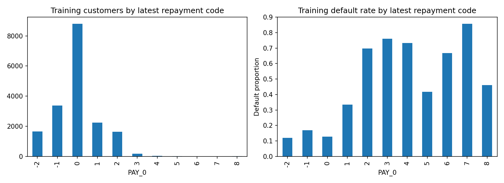
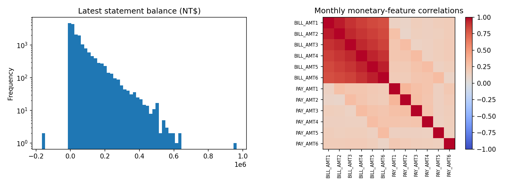
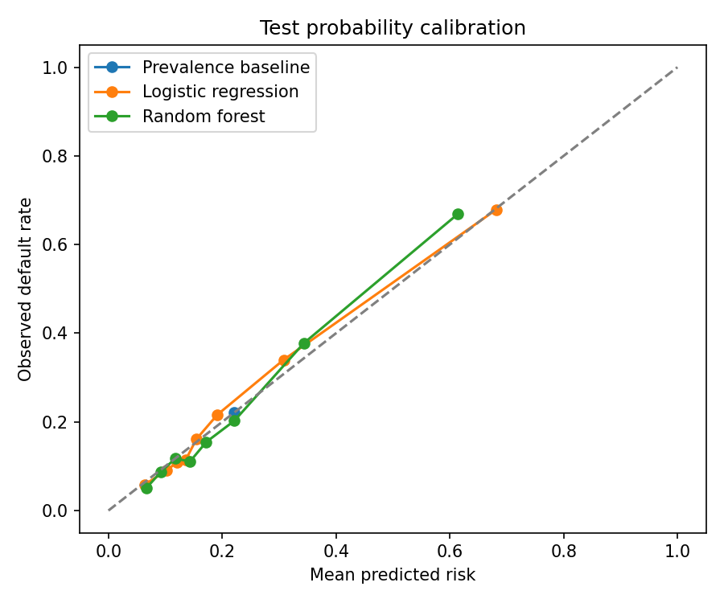
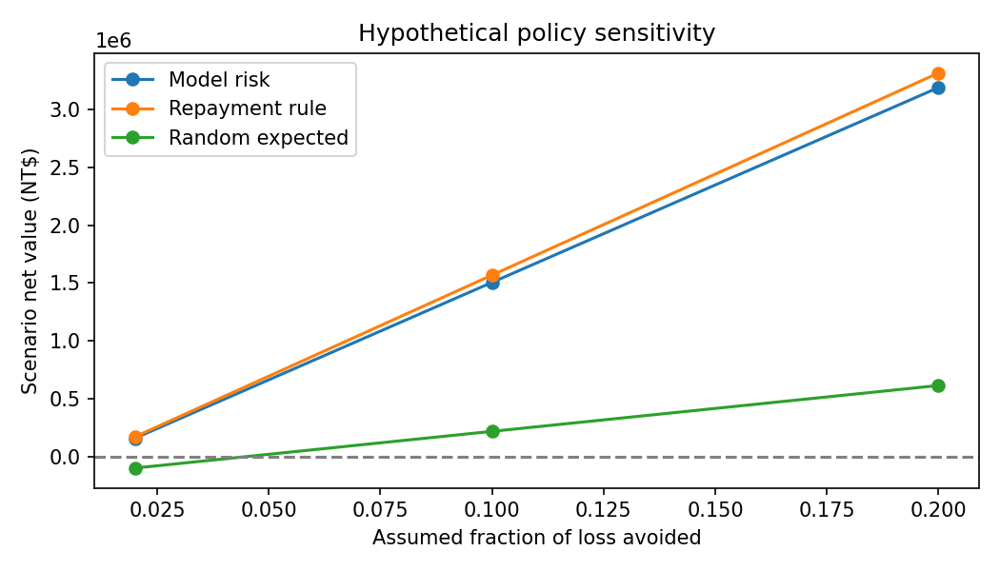

# Credit Default Risk: Turning Predictions into Review Priorities

## Abstract

This project examines how a bank could identify customers at risk of missing payments while reviewing only 10% of accounts. A predictive model captured 31.7% of defaults, compared with 31.5% for a simple repayment-history rule, suggesting that targeted review is useful but added model complexity may offer little practical benefit. The recommendation is to test the simple rule in a monitored pilot and measure whether the resulting outreach reduces losses.

**How can a bank identify more customers at risk of default without increasing its account-review workload?**

This project follows that question from data inspection through modeling and financial decision analysis. Using historical credit-card data, it compares reviewing customers at random, applying a simple repayment-history rule, and ranking customers with machine learning.

**The business finding:** reviewing the highest-risk 10% of test customers identified **31.7% of subsequent defaults**, about **3.17 times** the expected capture rate of random review. However, a simple repayment-status rule identified **31.5%**. Targeted review is promising in this sample; the added complexity of machine learning has not demonstrated a meaningful operational advantage.

## 1. Define the decision before building the model

The proposed use is to prioritize **existing customers for account review or supportive outreach**, using information available before the next-month outcome. It is not a loan-approval model.

The operational assumption is that staff can review **10% of accounts**. Fixing this capacity before evaluating results makes the comparison concrete: every policy must work with the same review budget.

A missed default represents a missed opportunity for intervention. Reviewing a customer who would not default consumes resources and may inconvenience them. Therefore, success means identifying useful concentrations of risk, estimating probabilities credibly, and examining whether an intervention could justify its cost—not simply maximizing classification accuracy.

## 2. Inspect the data: establish what the analysis can support

The workbook contains **30,000 customers**, 23 potential predictors, an ID, and a next-month default label. There are **6,636 defaults**, a **22.12%** default rate. Predictors cover credit limits, customer characteristics, and six months of repayment status, balances, and payments.

The data contain no blank cells and all IDs are unique. However, education, marriage, and repayment-status fields contain incompletely documented codes. These are retained as explicit categories rather than assigned invented meanings. Negative bill balances are preserved in modeling. ID is excluded because it is a record identifier, not a financial characteristic.

There are 35 repeated records after excluding ID, including the outcome. They are retained because distinct customers can have identical recorded profiles; their potential effect is examined later.

**Business interpretation:** a complete spreadsheet is not necessarily a fully understood dataset. Documenting uncertain codes and preserving original values avoids presenting unsupported cleaning assumptions as facts. The observed default rate also establishes a baseline: predicting “no default” for everyone would achieve **77.88% accuracy while detecting zero defaults**.

## 3. Separate development from evaluation

The sample is divided into **18,000 training**, **6,000 validation**, and **6,000 test** customers, with stratification to preserve the default proportion.

Training data support exploration and three-fold cross-validation. Validation provides an intermediate check of the fixed review policy. The test set provides the final evaluation after model selection. Encoding and scaling are fitted within training folds. The estimators remain trained on the training set; validation and test observations are not used for refitting.

Preliminary full-file descriptive inspection occurred before this workflow and is disclosed. Subsequent model selection uses training data only.

**Business interpretation:** separating these stages reduces the risk of reporting a result that merely reflects decisions tailored to the evaluation sample. Because the data represent one historical cohort, a random split still cannot demonstrate performance in future months or another market.

## 4. Explore repayment behavior: identify a plausible source of risk

Training-data default rates rise sharply across several latest repayment-status categories:

| Latest repayment code (`PAY_0`) | Training customers | Default rate |
|---|---:|---:|
| 0 | 8,805 | 12.8% |
| 1 | 2,245 | 33.5% |
| 2 | 1,635 | 69.7% |
| 3 | 184 | 76.1% |



**Business interpretation:** recent repayment status provides a strong signal for prioritizing review. This association motivates both a predictive model and a simple rule-based benchmark. It does not establish causation. Higher delay categories have small samples, so their rates should not be treated as precise or steadily increasing risk estimates. Codes −2 and 0 remain uninterpreted categories in preprocessing.

The training monetary summaries also show long upper tails: the median latest payment is approximately **NT$2,139**, compared with a mean of **NT$5,685**. The median latest bill is approximately **NT$22,345**, compared with a mean of **NT$51,473**. Monthly monetary correlations are examined alongside these distributions.



**Business interpretation:** averages alone can obscure substantial differences between accounts. Correlated monthly histories also require caution when attributing importance to one particular month. Continuous inputs are scaled for logistic regression; this first version uses original features rather than adding an extensive feature-engineering search.

## 5. Compare models: test whether complexity adds value

Three models serve different purposes:

- **Prevalence baseline:** assigns every customer the training default probability; it has no risk-ranking information.
- **Logistic regression:** tests a comparatively simple relationship between customer characteristics and default probability.
- **Random forest:** tests nonlinear relationships and interactions.

Average precision is the primary training cross-validation selection metric because the task concerns finding defaults within a ranked population. ROC-AUC measures overall ranking; Brier score evaluates probability error, with lower values better.

| Model | Training CV average precision | Training CV ROC-AUC | Training CV Brier score |
|---|---:|---:|---:|
| Prevalence baseline | 0.221 | 0.500 | 0.172 |
| Logistic regression | 0.546 | 0.770 | 0.135 |
| Random forest | 0.550 | 0.783 | 0.135 |

**Business interpretation:** both fitted models extract useful information beyond the base default rate. Random forest is selected by the prespecified metric, but its advantage over logistic regression is small. Selection is not evidence that the difference is statistically or commercially meaningful.

## 6. Validate the review policy: translate metrics into accounts

On validation data, random forest captured **29.9%** of defaults within the top 10% of accounts, with **66.2%** precision. The corresponding test results were **31.7%** recall and **70.2%** precision. This provides a second held-out check, although both subsets come from the same historical cohort.

| Model | Test ROC-AUC | Test average precision | Test Brier score |
|---|---:|---:|---:|
| Prevalence baseline | 0.500 | 0.221 | 0.172 |
| Logistic regression | 0.776 | 0.559 | 0.135 |
| Random forest | 0.782 | 0.565 | 0.134 |

ROC-AUC of 0.782 describes ranking ability; it does **not** mean 78.2% classification accuracy. Average precision summarizes the precision–recall tradeoff across ranking thresholds, rather than precision at the chosen capacity.

The test set contains **1,327 defaults**. At the fixed capacity of **600 reviews**:

| Review policy | Defaults captured | Share of all defaults captured |
|---|---:|---:|
| Random selection, mathematical expectation | 132.7 | 10.0% |
| Latest repayment-status rule | 418 | 31.5% |
| Logistic regression | 420 | 31.7% |
| Random forest | 421 | 31.7% |

The rule ranks accounts by descending `PAY_0`, with equal-code ties resolved by original row order. Random selection is an expectation, not an observed trial. The prevalence model cannot differentiate accounts; any top-capacity result from its tied scores depends on tie-breaking.

**Business interpretation:** random forest concentrates risk effectively: 421 of the 600 reviewed customers defaulted. It leaves **906 defaults outside the review group** and reviews **179 customers who did not default**. It captures only **three more defaults than the simple rule**, and one more than logistic regression. That is insufficient evidence to justify a more complex operating process.

Bootstrap 95% intervals for random forest are approximately **0.768–0.797 for ROC-AUC** and **0.534–0.597 for average precision**. These describe sampling uncertainty for this cohort; they do not test the significance of policy differences or capture future-market uncertainty.

## 7. Check probability credibility and model behavior



The calibration plot compares predicted probabilities with observed default frequencies. Both fitted models broadly track the diagonal in the plotted bins, while random forest understates observed risk in its highest plotted bin. Its test Brier score is **0.134**, compared with **0.172** for the prevalence baseline.

**Business interpretation:** the probability estimates improve on a constant base-rate forecast, but the plot is not a guarantee of calibration at every risk level or in future cohorts. Probability credibility matters because financial scenarios multiply estimated risk by assumed losses.

Validation permutation importance identifies `PAY_0` as the strongest individual feature: shuffling it reduces average precision by approximately **0.149**, compared with **0.028** for `PAY_2`. Other individual-feature effects are considerably smaller.

**Business interpretation:** the model's reliance on recent repayment behavior helps explain why the simple rule performs nearly as well. Importance measures predictive contribution, not causality; related monthly features can share information.

The subgroup audit shows observed default rates of **24.1% for SEX code 1** and **20.8% for code 2**, with mean predicted risks of **23.0%** and **21.6%**, respectively. Review rates are **9.7%** and **10.2%**. These aggregate summaries do not establish fairness or comparable error rates. Demographic-exclusion comparisons and fuller subgroup validation remain future work.

Thirteen test predictor profiles also appear in training. Removing these overlapping profiles leaves ROC-AUC and average precision essentially unchanged at **0.782** and **0.565**. This sensitivity check suggests those exact overlaps do not explain the reported ranking performance.

## 8. Connect risk prioritization to hypothetical financial value

Finding more defaults is useful only if the resulting action creates value. The analysis therefore considers:

**Expected loss = default probability × assumed exposure × assumed loss given default**

**Scenario net benefit = expected loss × assumed fraction of loss avoided − review cost**

The dataset does not contain actual exposure at default, recoveries, review costs, or intervention outcomes. Positive latest statement balances are used solely as an exposure proxy; negative balances are clipped to zero for this financial proxy and remain unchanged in modeling.

The illustrative base case assumes **60% loss given default**, **10% of loss avoided through intervention**, and **NT$300 per review**. For the 6,000-account test cohort:

| Policy | Probability-based scenario net value | Outcome-label-based scenario net value |
|---|---:|---:|
| Random forest ranking | NT$1,243,886 | NT$1,504,894 |
| Repayment-status rule | NT$1,275,724 | NT$1,567,834 |
| Random review, expected allocation | NT$198,070 | NT$216,678 |

**These are hypothetical scenario values, not measured or realized savings.** The first column uses predicted probabilities; the second substitutes observed default labels. Both still assume exposure, loss severity, and intervention effectiveness. The probability-based estimate also uses the selected model's probabilities to value every policy, so it is not an independent economic comparison.



The scenario grid varies loss given default from **30% to 90%**, the fraction of loss avoided from **2% to 20%**, and review cost from **NT$100 to NT$1,000**.

**Business interpretation:** economic value depends on what the bank can change after identifying risk. Under the base assumptions, the simple rule produces slightly greater scenario value despite capturing fewer defaults. The balances associated with reviewed accounts matter as well as the number of defaults. A model's small ranking advantage does not automatically translate into greater financial benefit.

## Conclusion: business outcome and theoretical impact

The project demonstrates how a bank could **prioritize limited credit-risk resources**. In this historical test sample, targeted review captured about **32% of defaults while reviewing 10% of customers**, compared with 10% expected under random selection.

If similar performance held in a current portfolio, this approach could help staff identify more vulnerable accounts within the same review workload. Effective, appropriately designed outreach could theoretically reduce losses, support customers earlier, and improve review efficiency. Actual impact would depend on current data, intervention effectiveness, account exposures, costs, and customer outcomes.

The most actionable finding is that **the simple repayment-history rule achieves almost the same default capture as machine learning and slightly higher value in the illustrative financial scenario**. The evidence supports testing targeted review, but does not yet justify adopting random forest solely for its added complexity. A simple rule is a credible pilot benchmark; a model would need to show meaningful additional value to warrant implementation and ongoing maintenance.

A pilot would need later-period validation, verified category and target definitions, actual exposure and recovery data, fuller fairness assessment, and a controlled measurement of intervention outcomes. Success should be judged by net avoided losses and customer outcomes—not only model scores.

## Reproduce and inspect the work

Use Python 3.9 or later. Create a virtual environment, install the dependencies, select that environment in VS Code, and run the notebook from top to bottom:

```bash
python3 -m venv .venv
source .venv/bin/activate
python -m pip install -r requirements.txt
```

Keep `default of credit card clients.xls` in the project root. Seeds are fixed; package-version differences can produce small numerical changes. The exact versions used are recorded in [environment_versions.txt](environment_versions.txt).

- [Executed analysis notebook](credit_risk_analysis.ipynb): explanations, code, figures, and outputs.
- [Executive summary](reports/executive_summary.md): compact business findings.
- [Training cross-validation results](reports/cross_validation.csv), [validation metrics](reports/validation_metrics.csv), and [test metrics](reports/test_metrics.csv): model comparisons.
- [Permutation importance](reports/permutation_importance.csv): predictive feature contributions.
- [Financial scenario grid](reports/financial_scenarios.csv): explicit assumptions and scenario outputs.

The original notebook is backed up locally in `backups/`, excluded from version control. No operational deployment or measured financial return is claimed.

## Data source and limitations

Yeh, I. (2009). *Default of Credit Card Clients* [Dataset]. UCI Machine Learning Repository. [Dataset and documentation](https://archive.ics.uci.edu/dataset/350/default+of+credit+card+clients). [DOI: 10.24432/C55S3H](https://doi.org/10.24432/C55S3H). License: CC BY 4.0.

The data describe a 2005 Taiwan cohort using April–September repayment histories and New Taiwan dollar amounts. Limitations include one historical observation window, no temporal validation, incompletely documented categories and default definition, and no actual loss or causal intervention evidence. This is an educational portfolio analysis; results should not be extrapolated directly to a current lending population.
